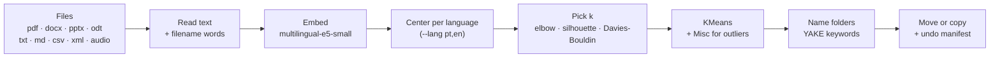
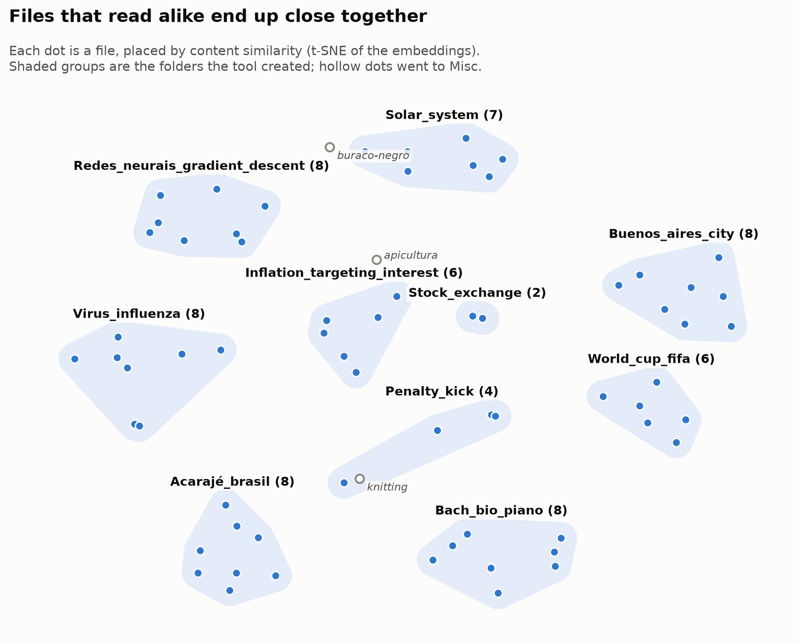

# File Organizer

[](https://github.com/RafaelSdeS/File-Organizer/actions/workflows/tests.yml)

A local CLI that reads the documents in a folder, groups them by what they are *about*, and moves them into folders named after each group's keywords. Everything runs on your machine; the only network access is a one-time download of the models.

`examples/demo/` is a flat folder of 68 Wikipedia excerpts: 8 topics with 8 texts each, half Portuguese and half English, plus 4 one-offs. After `organize-files examples/demo --lang pt,en`:

```
examples/demo/
├── Acarajé_brasil/                  (8)  feijoada, coxinha, churrasco, receita pao de queijo, …
├── Bach_bio_piano/                  (8)  bach_bio, mozart, violino, symphony, opera, …
├── Buenos_aires_city/               (8)  rio de janeiro, lisbon_trip, paris - roteiro, tokyo, …
├── Redes_neurais_gradient_descent/  (8)  redes neurais, gradient_descent, svm, transformers-notes, …
├── Virus_influenza/                 (8)  vacinas, flu_notes, antibiotics, sistema imune, …
├── Solar_system/                    (7)  sistema_solar, mars - overview, lua, supernova, …
├── World_cup_fifa/                  (6)  copa-do-mundo, pele, flamengo, fifa, …
├── Inflation_targeting_interest/    (6)  inflacao, juros, compound_interest, central-bank, PIB, …
├── Penalty_kick/                    (4)  penalty_kick, regra do impedimento, xadrez, origami
├── Stock_exchange/                  (2)  stock market basics, bolsa de valores
└── Misc/                            (3)  apicultura, knitting, buraco-negro
```

Each folder mixes both languages: `redes neurais` (pt) sits next to `gradient_descent` (en). Five of the eight topics come out complete. Football and economics split into sensible sub-topics (clubs and cups vs. rules; stock markets vs. interest and inflation). The four one-offs either go to `Misc` or join their nearest neighbours: chess and origami end up next to the football rules. One astronomy text also lands in `Misc`; the outlier cut-off is a tunable heuristic (`--misc-threshold`). Folder names are the clusters' top keywords, so some are better than others (`Bach_bio_piano`).

## How it works



1. **Read.** Text is extracted from each file (PDF, Office, plain text, or an offline Vosk transcription for audio). A subfolder counts as one document.
2. **Embed.** Each document becomes a vector with [`intfloat/multilingual-e5-small`](https://huggingface.co/intfloat/multilingual-e5-small) (multilingual, 512-token window). The filename's words are repeated in front of the content (`--path-weight`).
3. **Center per language.** Multilingual models still encode *which language* a text is in, strongly enough that a pt+en folder used to split by language instead of topic. When `--lang` lists several languages, each document's language is detected from its stopwords and that language's average vector is subtracted. On the demo's 64 topic texts, agreement with the true topics (adjusted Rand index at k = 8) goes from 0.34 to 1.00.
4. **Pick k.** KMeans is run for every k up to `--max-clusters`. Three metrics each vote for a k, and the median vote wins.
5. **Cluster.** KMeans runs with that k. Documents unusually far from their cluster's centre go to `Misc`.
6. **Name and move.** Each folder is named from its top YAKE keywords. Files are moved (or copied, with `--copy`), and every move is recorded in a manifest that `--undo` replays in reverse.

### Seeing a run: `--report`

`--report DIR` saves three charts of a run. The ones below are the demo run (`organize-files examples/demo --dry-run --lang pt,en --report docs/img`).

**Document map.** Every dot is a file, placed so that files with similar content sit close together (a t-SNE projection of the embeddings). The shaded outlines and labels are the folders the tool created. Hollow dots went to `Misc`.



**Choosing k.** Each metric votes for the k at its peak: the sharpest bend of the inertia curve (elbow), the best silhouette, and the best Davies-Bouldin score (its axis is flipped because lower is better). Here the votes are 4, 10 and 10, so the median picks 10. Davies-Bouldin replaced Calinski-Harabasz, which voted k = 2 on nearly every real folder; on this demo that dragged the median down to 4 and mixed topics together (adjusted Rand 0.35, against 0.85 now).


**Similarity.** How alike every pair of files is, sorted by folder. Dark blocks on the diagonal mean a folder's files resemble each other more than files in other folders. The smaller folders at the bottom are visibly weaker blocks.


The demo texts are the opening sections of Wikipedia articles, CC BY-SA 4.0 (see [`examples/ATTRIBUTION.md`](examples/ATTRIBUTION.md)).

## Installation

Requires Python 3.12+.

```bash
pip install -e .            # core: adds the organize-files command
pip install -e .[viz]       # + matplotlib, for --report
pip install -e .[audio]     # + tinytag/vosk, for audio metadata and transcription
```

Or `pip install -r requirements.txt` for everything, optional dependencies included. Audio transcription also needs `ffmpeg` on `PATH`; without it, audio files are still clustered by filename and tags. The embedding model (~470 MB) downloads on first run. Vosk models download per language to `~/.cache/vosk`.

## Usage

```bash
organize-files ~/Downloads --lang pt,en --dry-run     # preview only
organize-files ~/Downloads --lang pt,en               # asks before moving
organize-files --undo ~/Downloads/.file_organizer_manifest_<timestamp>.json
```

(Without installing, use `python -m src.document_analyzer.main` instead of `organize-files`.)

| Flag | What it does |
|---|---|
| `path` | Folder to organize (prompted if omitted) |
| `--lang CODES` | Language(s) of your documents, comma-separated (`pt`, `pt,en`). Selects the stopwords for folder names and the transcription language, and with several codes turns on per-language centering. Default `en` |
| `--dry-run` | Show the proposed folders without touching anything |
| `-y, --yes` | Skip the confirmation prompt |
| `--target-dir DIR` | Put the organized folders here instead of in place |
| `--copy` | Copy instead of move; originals stay where they are |
| `--undo MANIFEST` | Revert a previous run. Moved files go back, copies are deleted (never the last copy), and the emptied folders and the manifest are removed |
| `--report DIR` | Save the three charts above for this run (needs `[viz]`) |
| `--misc-threshold N` | Send documents more than mean + N std from their cluster centre to `Misc`; `0` disables (default `2.0`) |
| `--max-clusters N` | Largest k to consider (default `10`) |
| `--path-weight N` | Times the filename is repeated before the content (default `2`) |
| `--keyword-ngram N` / `--keyword-count N` | YAKE keyword length / how many to extract; the top 2 name the folder (defaults `2` / `5`) |
| `--exclude PATTERN` | Glob to skip, repeatable (`--exclude '*.log'`) |
| `--include-all` | Don't skip hidden entries, `__pycache__` or `node_modules` |
| `--verbose` / `--quiet` | DEBUG / WARNING logging (default INFO, which also shows a progress bar) |

**Safety.** Nothing moves without confirmation (or `-y`). An existing file is never overwritten. Folders created by a previous run are marked and skipped on the next run. Every run writes an undo manifest.

### Saved defaults

Every flag except `--dry-run`, `-y`, `--undo` and `--report` can be set in `~/.config/file-organizer.toml` (dashes become underscores). Flags on the command line still win:

```toml
lang = "pt,en"
max_clusters = 12
misc_threshold = 2.5
copy = true
exclude = ["*.log", "tmp_*"]
```

### Python API

```python
from document_analyzer import DocumentAnalyzer

analyzer = DocumentAnalyzer(lang="pt,en")  # same knobs as the CLI flags
folders = analyzer.analyze_directory("/path/to/documents")  # {folder: [files]}
manifest = analyzer.organize_files(folders, source_dir="/path/to/documents",
                                   target_dir="/path/to/organized", copy=False)
```

`analyze_directory` raises `ValueError`, `FileNotFoundError` or `PermissionError` for a bad path, and `RuntimeError` if embedding or clustering fails. A file that can't be read is logged and still clustered by its name.

## License

[MIT](LICENSE). The demo texts in `examples/demo/` are CC BY-SA 4.0. See [`examples/ATTRIBUTION.md`](examples/ATTRIBUTION.md).
