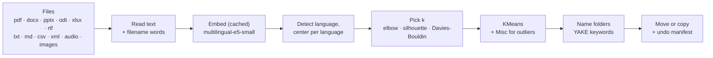
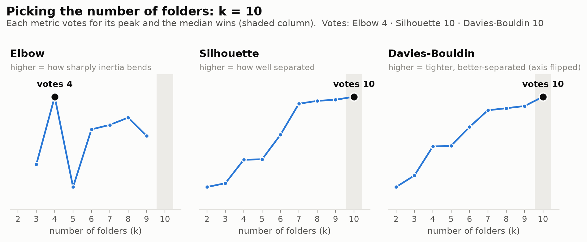
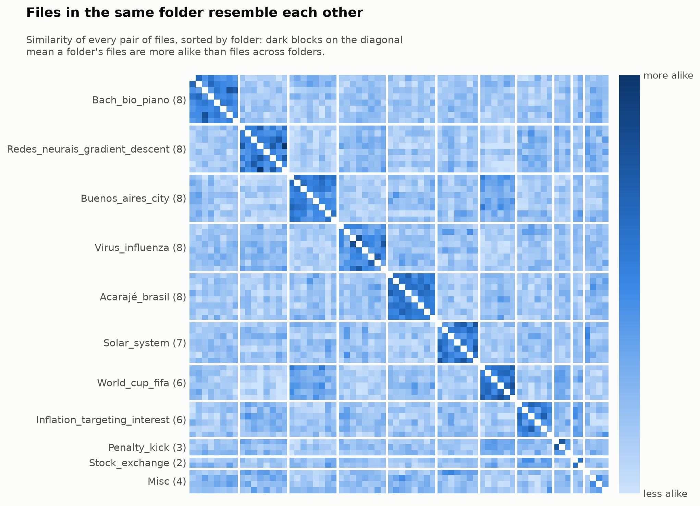

# File Organizer

[](https://github.com/RafaelSdeS/File-Organizer/actions/workflows/tests.yml)

A local CLI (and a local web page, `--ui`) that reads the documents in a folder, groups them by what they are *about*, and moves them into folders named after each group's keywords. Everything runs on your machine; the only network access is a one-time download of the models, and a test proves it.

Why this and not an LLM that sorts file by file? It looks at the whole folder at once, so the folders come from your documents, not from a generic list of categories. It runs on a CPU in minutes with a 470 MB model, gives the same answer every time, and can file new documents into the folders you already have (`--into`), so moving a file by hand is all it takes to teach it.

`examples/demo/` is a flat folder of 68 Wikipedia excerpts: 8 topics with 8 texts each, half Portuguese and half English, plus 4 one-offs. After `organize-files examples/demo`, with no options:

```
examples/demo/
├── Acarajé_brasil/                  (8)  feijoada, coxinha, churrasco, receita pao de queijo, …
├── Bach_bio_piano/                  (8)  bach_bio, mozart, violino, symphony, opera, …
├── Buenos_aires_city/               (8)  rio de janeiro, lisbon_trip, paris - roteiro, tokyo, …
├── Redes_neurais_gradient_descent/  (8)  redes neurais, gradient_descent, svm, transformers-notes, …
├── Virus_influenza/                 (8)  vacinas, flu_notes, antibiotics, sistema imune, …
├── Solar_system/                    (7)  sistema_solar, mars - overview, lua, supernova, …
├── World_cup_fifa/                  (6)  copa-do-mundo, pele, flamengo, fifa, …
├── Inflation_targeting_interest/    (6)  inflacao, juros, compound_interest, central-bank, PIB, …
├── Penalty_kick/                    (3)  penalty_kick, regra do impedimento, xadrez
├── Stock_exchange/                  (2)  stock market basics, bolsa de valores
└── Misc/                            (4)  apicultura, knitting, origami, buraco-negro
```

The languages are detected on their own, and each folder mixes both: `redes neurais` (pt) sits next to `gradient_descent` (en). Five of the eight topics come out complete. Football and economics split into sensible sub-topics (clubs and cups vs. rules; stock markets vs. interest and inflation). Three of the four one-offs go to `Misc`; chess joins the football rules, which is at least about game rules. One astronomy text also lands in `Misc`. Agreement with the true topics is 0.90 (adjusted Rand index, 1.0 = perfect). Folder names are the clusters' top keywords, so some are better than others (`Bach_bio_piano`).

## How it works



1. **Read.** Text is extracted from the start of each file (PDF, Office, RTF, plain text, an offline Vosk transcription for audio, or Tesseract OCR for images and scanned PDFs). A subfolder counts as one document.
2. **Embed.** Each document becomes a vector with [`intfloat/multilingual-e5-small`](https://huggingface.co/intfloat/multilingual-e5-small) (multilingual, 512-token window), run by onnxruntime (no PyTorch). The filename's words are repeated in front of the content (`--path-weight`). Vectors are cached, so a document is only embedded once.
3. **Center per language.** Multilingual models still encode *which language* a text is in, strongly enough that a mixed folder would otherwise split by language instead of topic. Each document's language is detected from its stopwords (English, Portuguese, Spanish, French, German, Italian or Dutch), and that language's average vector is subtracted. On the demo's 64 topic texts, agreement with the true topics goes from 0.34 to 1.00.
4. **Pick k.** KMeans is run for every k up to `--max-clusters`. Three metrics each vote for a k, and the median vote wins.
5. **Cluster.** KMeans runs with that k. A document goes to `Misc` instead if it is unusually far from its cluster's centre, closer to another cluster than to its own, or left alone in a cluster.
6. **Name and move.** Each folder is named from its top YAKE keywords. Files are moved (or copied, with `--copy`), and every move is recorded in a manifest that `--undo` replays in reverse.

### Seeing a run: `--report`

`--report DIR` saves three charts of a run. The ones below are the demo run (`organize-files examples/demo --dry-run --report docs/img`).

**Document map.** Every dot is a file, placed so that files with similar content sit close together (a t-SNE projection of the embeddings). The shaded outlines and labels are the folders the tool created. Hollow dots went to `Misc`.


**Choosing k.** Each metric votes for the k at its peak: the sharpest bend of the inertia curve (elbow), the best silhouette, and the best Davies-Bouldin score (its axis is flipped because lower is better). Here the votes are 4, 10 and 10, so the median picks 10. Davies-Bouldin replaced Calinski-Harabasz, which voted k = 2 on nearly every real folder; on this demo that dragged the median down to 4 and mixed topics together.



**Similarity.** How alike every pair of files is, sorted by folder. Dark blocks on the diagonal mean a folder's files resemble each other more than files in other folders. The smaller folders at the bottom are visibly weaker blocks.



The demo texts are the opening sections of Wikipedia articles, CC BY-SA 4.0 (see [`examples/ATTRIBUTION.md`](examples/ATTRIBUTION.md)). Their true topics are in [`examples/demo_topics.tsv`](examples/demo_topics.tsv), which the quality test checks against.

### Speed

On a laptop CPU, about 2,000 files (a third of them PDFs) take about 4 minutes, two thirds of it computing the embeddings. Only the first 5,000 characters of each file are read, since the model sees about 512 tokens anyway. With `--verbose` or the default logging, each stage reports its time.

Embeddings are cached in `~/.cache/file-organizer/embeddings.sqlite` (readable only by you; entries unused for 90 days are dropped; `--no-cache` skips it, deleting the file clears it). A second run on the same folder embeds nothing and doesn't even load the model: on the demo, embedding goes from 8 s to 0 and the whole run takes about 5 s.

The model runs on onnxruntime instead of PyTorch: the same vectors (cosine 1.00000 on every demo document), the same speed, and about 130 MB of dependencies instead of about 900 MB (several GB with PyTorch's default CUDA build). CPU only.

## Installation

Requires Python 3.12+.

```bash
pip install -e .            # core: adds the organize-files command
pip install -e .[viz]       # + matplotlib, for --report
pip install -e .[audio]     # + tinytag/vosk, for audio metadata and transcription
```

Or `pip install -r requirements.txt` for everything, optional dependencies included, or install a release straight from GitHub: `pip install "document-analyzer[viz] @ git+https://github.com/RafaelSdeS/File-Organizer@v0.2.0"`. Audio transcription also needs `ffmpeg` on `PATH`; without it, audio files are still clustered by filename and tags. OCR of images and scanned PDFs needs `tesseract` on `PATH` with its language packs (e.g. `apt install tesseract-ocr tesseract-ocr-por`), and Pillow (part of `[viz]`) for black-and-white "fax mode" scans; without tesseract they are clustered by name, and the log says how many PDFs had no text. The embedding model (~470 MB) downloads on first run. Vosk models download per language to `~/.cache/vosk`.

## Usage

```bash
organize-files ~/Downloads --dry-run      # preview only
organize-files ~/Downloads                # asks before moving
organize-files --ui                       # the same, in a page in your browser
organize-files ~/Downloads --into ~/Documents   # file into the folders you already have
organize-files --history                  # past runs, each with its undo command
organize-files --undo ~/Downloads/.file_organizer_manifest_<timestamp>.json
```

(Without installing, use `python -m src.document_analyzer.main` instead of `organize-files`.)

| Flag | What it does |
|---|---|
| `path` | Folder to organize (prompted if omitted) |
| `--lang CODES` | `auto` (default) detects each file's language among en, pt, es, fr, de, it and nl. A comma-separated list (`pt`, `pt,en`) restricts detection to those. Also sets the audio transcription language (English under `auto`, since audio is read before detection) |
| `--dry-run` | Show the proposed folders without touching anything |
| `-y, --yes` | Skip the confirmation prompt |
| `--target-dir DIR` | Put the organized folders here instead of in place |
| `--copy` | Copy instead of move; originals stay where they are |
| `--undo MANIFEST` | Revert a previous run. Moved files go back, copies are deleted (never the last copy), and the emptied folders and the manifest are removed |
| `--history` | List past runs, newest first, with the command to undo each one (kept in `~/.local/state/file-organizer/history.jsonl`) |
| `--ui` | Open a page in your browser to analyze, review, edit and apply (see below) |
| `--into DIR` | File documents into the subfolders `DIR` already has, when they fit; the rest get new folders in `DIR` |
| `--plan FILE` / `--apply FILE` | Write the proposal as an editable text file instead of moving; apply a (hand-edited) plan |
| `--depth N` | `2` or more splits folders of 20+ files into subfolders (default `1`) |
| `--llm-names MODEL` | Name folders with a model on a local [Ollama](https://ollama.com) server, one request per folder (default off: keyword names). With `qwen2.5:1.5b`, 7 of the demo's 10 names were better than the keyword ones (`Classical_Music` for `Bach_bio_piano`) and 2 worse |
| `--no-cache` | Don't read or write the embedding cache |
| `--report DIR` | Save the three charts above for this run (needs `[viz]`) |
| `--misc-threshold N` | Send to `Misc` documents more than mean + N std from their cluster centre, closer to another cluster, or alone in one; `0` disables `Misc` (default `2.0`) |
| `--max-clusters N` | Largest k to consider (default `10`) |
| `--path-weight N` | Times the filename is repeated before the content (default `2`) |
| `--keyword-ngram N` / `--keyword-count N` | YAKE keyword length / how many to extract; the top 2 name the folder (defaults `2` / `5`) |
| `--exclude PATTERN` | Glob to skip, repeatable (`--exclude '*.log'`) |
| `--include-all` | Don't skip hidden entries, `__pycache__` or `node_modules` |
| `--verbose` / `--quiet` | DEBUG / WARNING logging (default INFO, which also shows a progress bar and stage timings) |
| `--version` | Print the installed version |

**Safety.** Nothing moves without confirmation (or `-y`). An existing file is never overwritten. Folders created by a previous run are marked and skipped on the next run. Every run writes an undo manifest and a line in the history. Files that contain a CPF (check digits verified) or a card number (Luhn) are flagged in the output, the plan and the page, so you know where your ID scans ended up. They are only flagged, never moved on that basis.

**Network.** After the first run, nothing goes over the network. The embedding model (~470 MB) is downloaded from huggingface.co once, pinned to a fixed revision; every later run loads it from the local cache without even checking for updates. Vosk models are downloaded once per language, and only if you organize audio. This is tested, not just promised: `tests/test_quality.py` blocks and records every non-loopback connection and DNS lookup while it builds the analyzer and organizes the demo, and fails if anything tried. `--ui` listens on 127.0.0.1 only, and `--llm-names` talks only to 127.0.0.1:11434, never through a proxy.

### The page: `--ui`

`organize-files --ui` (or `organize-files ~/Downloads --ui` to start analyzing right away) opens a page in your browser. Type a folder (and optionally an `--into` folder), and the proposal comes back with each file's similarity to its folder, lowest first, since those are the ones to check. Rename folders, move files between them with the menu next to each file, add folders, see the document map, then Apply. History lists past runs with an Undo button.

The page is served by Python's standard library on 127.0.0.1 only. It's one HTML file that loads nothing from anywhere, and the server's Content-Security-Policy forbids it. Each run gets a fresh access token (in the link the terminal prints), and requests naming another host are refused.

### Your own folders: `--into`

`organize-files ~/Downloads --into ~/Documents` files each new document into the existing subfolder of `~/Documents` it resembles. "Resembles" means it is no farther from that folder's average than that folder's own files usually are (the same rule, and `--misc-threshold`, as `Misc`). Documents that fit nowhere get new folders, as usual. Your folders are the training data: move a misfiled document by hand, and the next run takes that into account. To run it regularly, a cron job or systemd timer with `-y` is enough. In a test that took 10 files out of an organized demo, 9 went back to their folder; the tenth came from a folder left with a single file and went to `Misc`.

### Editing the plan

```bash
organize-files ~/Downloads --plan plan.txt   # writes the proposal, moves nothing
$EDITOR plan.txt                            # rename [folders], move or delete lines
organize-files --apply plan.txt             # moves as written (no model needed)
```

Each line is `similarity<TAB>file`, lowest first within a folder. An applied plan is checked first: folder names must stay inside the target, and every file must be in the source folder and listed once.

### Saved defaults

Every flag except `--dry-run`, `-y`, `--undo`, `--history`, `--version`, `--report`, `--plan`, `--apply` and `--ui` can be set in `~/.config/file-organizer.toml` (dashes become underscores). Flags on the command line still win:

```toml
lang = "pt,en"        # restrict detection; the default is "auto"
max_clusters = 12
misc_threshold = 2.5
copy = true
exclude = ["*.log", "tmp_*"]
```

### Python API

```python
from document_analyzer import DocumentAnalyzer

analyzer = DocumentAnalyzer()  # same knobs as the CLI flags, e.g. lang="pt,en", depth=2
folders = analyzer.analyze_directory("/path/to/documents")  # {folder: [files]}; into="/path" for --into
analyzer.last_run["scores"]     # {file: similarity to its folder}
analyzer.last_run["sensitive"]  # {file: ["cpf", "card"]}
manifest = analyzer.organize_files(folders, source_dir="/path/to/documents",
                                   target_dir="/path/to/organized", copy=False)
```

`organize_files` is a static method (`DocumentAnalyzer.organize_files(...)` needs no model). `analyze_directory` raises `ValueError`, `FileNotFoundError` or `PermissionError` for a bad path, and `RuntimeError` if embedding or clustering fails. A file that can't be read is logged and still clustered by its name.

## Development

```bash
python -m unittest discover tests                    # unit tests (model mocked, ~6 s)
RUN_QUALITY=1 python -m unittest tests.test_quality  # real model on examples/demo
```

CI runs the unit tests on Linux, Windows and macOS, and the quality test in a separate job.

## License

[MIT](LICENSE). The demo texts in `examples/demo/` are CC BY-SA 4.0. See [`examples/ATTRIBUTION.md`](examples/ATTRIBUTION.md).
